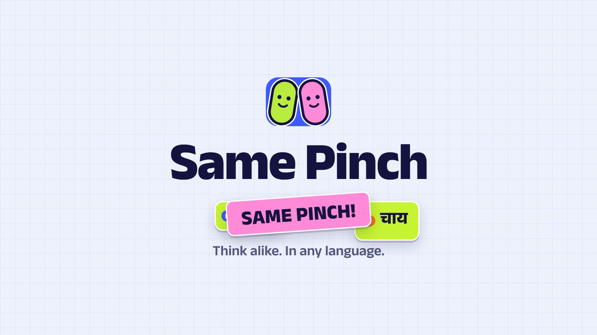
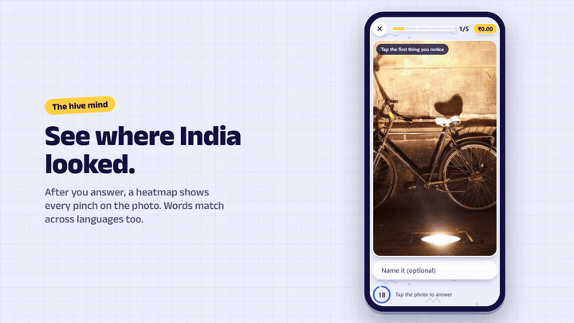

# Same Pinch 🤏

> **Think alike. In any language.** Two strangers see the same photo. Tap the same spot, or say the same thing
> (*naayi* = *kutta* = *dog*), and it's a **SAME PINCH!**

[](docs/media/same-pinch-promo.mp4)

**▶ [Watch the promo video (MP4, 48 s, 1080p)](docs/media/same-pinch-promo.mp4)**

<p align="center"></p>

Same Pinch is a responsive, offline-first web game (PWA) for India. Every round, you and a real person somewhere
in the country look at the same picture. You tap the first thing you notice, and can name it in your own
language. When your answers agree, that agreement is a **verified human label**, real data work (the ESP Game
principle), so verified matches earn a little money. Competition only ever earns XP, badges and bragging
rights.

---

## How a round works

1. **Notice.** A photo fills the screen. Tap the first thing your eye goes to.
2. **Name it (optional).** Up to three words. Smart Chips finish the word you're typing, in *your* language.
3. **Lock in.** Your answer is stored on the server *before* anything about your partner reaches your phone.
4. **Discover.** Their pinch pops in: a glow if you chose the same spot, a dashed thread if not. Then a
   **crowd heatmap** shows where everyone else looked ("41% pinched here too").
5. **Connect.** Their words appear in their language. Same meaning across languages is a **Bhasha Pinch**.

A pack is 5 rounds, about a minute. At the end the rounds are dealt back as cards that flip over in 3D, XP
fills up, and flame, badges and newly synced states pop one by one.

## What's in it

| | |
|---|---|
| **The game** | Pinch the Picture, word matching across 6 languages, burnt words, a hidden-quality check, recorded partners (so it plays offline), crowd heatmaps, rematches with people you've matched before |
| **Keep coming back** | Flame streak with freezes, 5 levels, 13 badges (including *Brain Twin*: 3 matches with one person in a week), the Think Like India daily challenge, a Sync Map of all 36 states and UTs, a weekly XP board |
| **Hot hand** | Three pinches in a row put the next round on half time for double XP |
| **People** | The people you've matched with, and one-tap preset notes (no free-text chat between strangers) |
| **Money, done right** | ₹ only for verified matches, with a pay multiplier for answer quality. **Never** for winning, streaks or luck (India's Online Gaming Act, 2025). No deposits. Earned money never goes down |
| **Every screen** | Separate phone, tablet and desktop layouts: one-thumb play on phones, a curved animated rail on desktop |
| **Languages** | UI in English, हिन्दी, ಕನ್ನಡ, தமிழ். Words in those plus తెలుగు and मराठी, typed in script or romanised |

## Built with

| Layer | Choice |
|---|---|
| Web app | React 19 · Vite · Tailwind CSS v4 (one `theme.css` for every token) · Motion · TanStack Query · Dexie (offline queue) · PWA |
| API | Node.js · Express 5 · zod contracts shared with the web app · Drizzle ORM |
| Data | PostgreSQL (Neon in production, Docker locally) |
| Hosting | Vercel (web + API), free tier. See [`docs/FREE_STACK.md`](./docs/FREE_STACK.md) |

Performance is a feature: Lighthouse ≥ 95 on mobile and desktop, at most 150 KB of JavaScript before first paint
(currently 143.7 KB gzip), and transform/opacity-only animation with reduced-motion fallbacks.

## Repository layout

```
frontend/   React web app (features/<screen>, components/, styles/theme.css, locales/)
backend/    Express API (routes → services → Drizzle), migrations in backend/drizzle/
shared/     zod schemas, constants and text helpers used by both
content/    prompt photo credits
docs/       product, design, architecture and decision records (index below)
```

The three packages are independent: each has its own `package.json` and lockfile.

## Run it locally

Needs **Node 22+** and **Docker**.

```bash
npm run setup                              # installs root, shared/, backend/, frontend/
cp backend/.env.example backend/.env       # then fill the three secrets: openssl rand -base64 48
npm run db:up                              # Postgres 16 on localhost:5433
npm run db:migrate --prefix backend && npm run db:seed --prefix backend
npm run dev                                # API on :3000, web on :5173 (the web proxies /api)
```

Open http://localhost:5173. The first visit plays the welcome story and a practice round. To jump straight in
with history, choose **"I already play"** and use the demo restore code **`SAME7777`**.

Google sign-in is optional: set `GOOGLE_CLIENT_ID`, `GOOGLE_CLIENT_SECRET` and `GOOGLE_REDIRECT_URI` in
`backend/.env` (JavaScript origin `http://localhost:5173`, redirect `http://localhost:3000/api/auth/google/callback`).

### Commands

| Command | What it does |
|---|---|
| `npm run dev` | API + web with hot reload |
| `npm run build` | Build the API (tsup) and the web app (Vite + PWA) |
| `npm run lint` · `npm run typecheck` · `npm test` | Quality gates across all three packages |
| `npm run size --prefix frontend` | First-paint budget (JS ≤ 150 KB, CSS ≤ 18 KB gzip) |
| `npm run db:up` / `npm run db:down` | Start / stop local Postgres |
| `npm run db:migrate --prefix backend` | Apply migrations in `backend/drizzle/` |
| `npm run db:seed --prefix backend` | Seed prompts, partners and the demo account (idempotent) |
| `npm run db:generate --prefix backend` | New migration after editing `backend/src/db/schema.ts` |
| `npm run fetch:photos --prefix frontend` | Refresh the CC0 prompt photos (credits in `content/CREDITS.md`) |

### Re-making the promo video

The video is recorded from the real app, so it can be regenerated after UI changes. It needs ffmpeg on your PATH.

```bash
node frontend/scripts/promo/reset-demo-db.mjs    # a fresh <db>_promo database (your dev data is untouched)
# run the API on that database (the script prints the DATABASE_URL), plus the web app
npm run promo:capture --prefix frontend          # records 4 scenes from the running app
npm run promo:render --prefix frontend           # composes and encodes docs/media/*.mp4, poster and GIF
```

## Ground rules

Read [`AGENTS.md`](./AGENTS.md) before changing code. In short: the server decides every match, money is
for work and never for winning, everything works offline, and every screen stays under the performance budget.
Settled design questions live in [`docs/DECISIONS.md`](./docs/DECISIONS.md).

## Docs

| File | What's inside |
|---|---|
| [`AGENTS.md`](./AGENTS.md) | Rules for contributors and AI coding agents. Read first |
| [`docs/PRODUCT.md`](./docs/PRODUCT.md) | Users, constraints, research, scope, metrics |
| [`docs/GAME_DESIGN.md`](./docs/GAME_DESIGN.md) | Every mechanic, formula, level, badge and the legal rule |
| [`docs/DESIGN_SYSTEM.md`](./docs/DESIGN_SYSTEM.md) · [`docs/UI_DIRECTION.md`](./docs/UI_DIRECTION.md) | Palette, type, the single `theme.css`, creative direction |
| [`docs/RESPONSIVE.md`](./docs/RESPONSIVE.md) | Breakpoints and the separate phone / tablet / desktop layouts |
| [`docs/UX_STATES.md`](./docs/UX_STATES.md) · [`docs/SCREENS.md`](./docs/SCREENS.md) | Copy rules, loading/empty/error states, every screen |
| [`docs/COMPONENTS.md`](./docs/COMPONENTS.md) · [`docs/MOTION.md`](./docs/MOTION.md) | Component inventory, animation and haptics |
| [`docs/ARCHITECTURE.md`](./docs/ARCHITECTURE.md) · [`docs/BACKEND.md`](./docs/BACKEND.md) | System design, offline play, the API pipeline |
| [`docs/API.md`](./docs/API.md) · [`docs/DATA_MODEL.md`](./docs/DATA_MODEL.md) | Endpoint contracts, PostgreSQL schema |
| [`docs/CONTENT_I18N.md`](./docs/CONTENT_I18N.md) | Prompts, lexicon, languages |
| [`docs/PERFORMANCE.md`](./docs/PERFORMANCE.md) · [`docs/ACCESSIBILITY.md`](./docs/ACCESSIBILITY.md) | Budgets and the a11y checklist |
| [`docs/SECURITY.md`](./docs/SECURITY.md) · [`docs/TESTING.md`](./docs/TESTING.md) | Threat model, anti-cheat, the test strategy |
| [`docs/TECH_STACK.md`](./docs/TECH_STACK.md) · [`docs/FREE_STACK.md`](./docs/FREE_STACK.md) · [`docs/DEPLOYMENT.md`](./docs/DEPLOYMENT.md) | Library choices, ₹0 services, deploying |
| [`docs/DECISIONS.md`](./docs/DECISIONS.md) | Settled conflicts between docs (wins over the others) |

*Prompt photos are CC0; see [`content/CREDITS.md`](./content/CREDITS.md). Pay figures are demo money in this build.*
