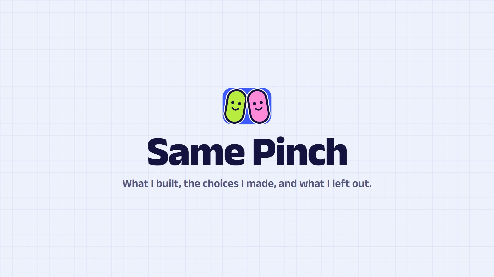

# Same Pinch 🤏

> **Do two strangers notice the same thing?** You see a photo and tap the first thing your eye goes to. Someone
> else in India saw the same photo. Same spot, or the same meaning in any language (*naayi* = *कुत्ता* = *dog*):
> that's a **SAME PINCH!**

| | |
|---|---|
| **Live app** | **[samepinch.vercel.app](https://samepinch.vercel.app)** — open it on a phone |
| **Explainer** | ▶ [2:51 video](https://drive.google.com/file/d/16SGHrvEjWxoa3xB14-F7uDC9NKV2cfOK/view?usp=sharing) · [written version](EXPLAINER.md) |
| **Try with history** | On the welcome screen tap **I already play** → restore code **`SAME7777`** |

[](docs/media/same-pinch-explainer.mp4)

<p align="center"></p>

---

## What it is

A responsive, offline-first web game (PWA) for India. A pack is five photos, about a minute:

1. **Notice.** Tap the first thing your eye goes to.
2. **Name it (optional).** Up to three words in any of six languages; Smart Chips finish the word you're typing.
3. **Lock in.** Your answer is stored on the server *before* anything about your partner reaches your phone.
4. **Discover.** Their pin appears, then a heatmap of where everyone else pinched ("41% pinched here too").
5. **Connect.** Their words, in their language. The same meaning across languages is a **Bhasha Pinch**.

Every agreement is a human-verified label, so verified matches earn a little (demo) money. Everything
competitive — streaks, levels, badges, the weekly board — earns XP, never money.

**Highlights:** play before sign-up (welcome story + 3 practice rounds) · crowd heatmaps · hot-hand bonus ·
rematches with past partners · Think Like India daily challenge · India map of 36 states and UTs · 13 badges ·
UI in English, हिन्दी, ಕನ್ನಡ, தமிழ் · works offline · separate phone, tablet and desktop layouts.

**Why it's built this way, and what's not built yet:** see [EXPLAINER.md](EXPLAINER.md).

---

## Run it locally

You need **Node.js 22+**, **npm**, and **Docker** (for PostgreSQL). Tested on Windows, macOS and Linux.

```bash
git clone https://github.com/vivekbeast/same-pinch.git
cd same-pinch

npm run setup      # 1. install dependencies (root, shared/, backend/, frontend/)
npm run env        # 2. create backend/.env with fresh secrets
npm run db:setup   # 3. start Postgres in Docker, create the tables, load the demo data
npm run dev        # 4. API on http://localhost:3000, web app on http://localhost:5173
```

Open **<http://localhost:5173>**. You'll see the welcome story; tap **Let's play** to start the practice rounds, or
**I already play** → **`SAME7777`** to jump in as a demo player with history.

<details>
<summary><b>If something doesn't work</b></summary>

| Symptom | Fix |
|---|---|
| `npm run db:setup` fails to connect | Start Docker Desktop first, then run it again. Postgres listens on **localhost:5433** (not 5432), so it won't clash with a local Postgres. |
| Port 3000 or 5173 is busy | Stop whatever is using it, or change `PORT` in `backend/.env`. |
| `npm run env` says `.env` already exists | That's fine — it never overwrites. Delete `backend/.env` to regenerate it. |
| Want a clean database | `npm run db:reset --prefix backend` wipes it, re-creates the tables and reloads the demo data. |
| Want to stop Postgres | `npm run db:down` |

Google sign-in is optional and hidden until configured: set `GOOGLE_CLIENT_ID`, `GOOGLE_CLIENT_SECRET` and
`GOOGLE_REDIRECT_URI` in `backend/.env` (JavaScript origin `http://localhost:5173`, redirect URI
`http://localhost:3000/api/auth/google/callback`).
</details>

### Everyday commands

| Command | What it does |
|---|---|
| `npm run dev` | API + web app with hot reload |
| `npm test` | All tests (145: API and scoring against a real Postgres, game rules, shared helpers) |
| `npm run lint` · `npm run typecheck` | Lint and type-check all three packages |
| `npm run build` | Production build of the API and the web app |
| `npm run size --prefix frontend` | Checks the JavaScript budget (≤ 150 KB before first paint) after a build |
| `npm run db:reset --prefix backend` | Fresh database with demo data |
| `npm run db:generate --prefix backend` | New migration after editing `backend/src/db/schema.ts` |

CI ([`.github/workflows/ci.yml`](.github/workflows/ci.yml)) runs lint, types, tests, the build and the size
budget on every push and pull request.

---

## How it's built

```text
 Phone (PWA)                        API (Express 5 on Vercel)             PostgreSQL (Neon)
 ───────────                        ─────────────────────────             ─────────────────
 React 19 · Vite · Tailwind  ──▶    zod validation → services        ──▶  answers, packs, ledger,
 Motion · TanStack Query            score each round in one               lexicon, recorded partners
 packs + answer queue in IndexedDB  transaction (partner, match, ₹, XP)
```

| Layer | Stack |
|---|---|
| Web app | React 19, Vite, Tailwind CSS v4 (one `theme.css` holds every token), Motion, TanStack Query, Dexie (IndexedDB), PWA |
| API | Node.js 22, Express 5, zod contracts shared with the web app, Drizzle ORM |
| Data | PostgreSQL 16 locally (Docker), Neon in production |
| Hosting | Vercel (web app + API as a serverless function, Singapore region), free tier |

**Measured on the live site:** Lighthouse desktop 100 / 100 / 100 / 100 and mobile 93 / 100 / 100 / 100
(performance, accessibility, best practices, SEO); 143.8 KB of JavaScript before first paint; zero layout shift.

### Repository layout

```text
same-pinch/
├── frontend/              React web app
│   ├── src/features/      one folder per screen (play, results, daily, people, profile, wallet, …)
│   ├── src/components/    shared UI (game board, reveal, nav rail, primitives in ui/)
│   ├── src/styles/theme.css   every colour, font, radius and animation token
│   ├── src/locales/       en, hi, kn, ta
│   └── scripts/promo/     records the real app and renders the videos in docs/media/
├── backend/               Express API
│   ├── src/routes/ → src/services/ → src/db/    routes → business rules → Drizzle
│   ├── src/domain/        pure, unit-tested game rules (matching, pay, XP, streaks, heatmap)
│   ├── drizzle/           SQL migrations
│   └── test/              API tests against a real Postgres
├── shared/                zod schemas, constants and text helpers used by both sides
└── docs/                  product, game design, architecture, decisions; videos in docs/media/
```

The three packages are independent: each has its own `package.json` and lockfile (no npm workspace).

---

## Docs

Start with **[EXPLAINER.md](EXPLAINER.md)**, then go deeper:

| File | What's inside |
|---|---|
| [`docs/GAME_DESIGN.md`](docs/GAME_DESIGN.md) | Every mechanic, formula, level and badge, and the legal rule on money |
| [`docs/ARCHITECTURE.md`](docs/ARCHITECTURE.md) · [`docs/BACKEND.md`](docs/BACKEND.md) | System design, offline play, the scoring pipeline |
| [`docs/API.md`](docs/API.md) · [`docs/DATA_MODEL.md`](docs/DATA_MODEL.md) | Endpoint contracts and the database schema |
| [`docs/DECISIONS.md`](docs/DECISIONS.md) | 56 settled trade-offs, newest last (wins over the other docs) |
| [`docs/PRODUCT.md`](docs/PRODUCT.md) | Users, constraints, research, scope |
| [`docs/DESIGN_SYSTEM.md`](docs/DESIGN_SYSTEM.md) · [`docs/UI_DIRECTION.md`](docs/UI_DIRECTION.md) · [`docs/MOTION.md`](docs/MOTION.md) | Visual language, tokens, animation |
| [`docs/RESPONSIVE.md`](docs/RESPONSIVE.md) · [`docs/UX_STATES.md`](docs/UX_STATES.md) · [`docs/SCREENS.md`](docs/SCREENS.md) | Layouts per device, copy and states, every screen |
| [`docs/PERFORMANCE.md`](docs/PERFORMANCE.md) · [`docs/ACCESSIBILITY.md`](docs/ACCESSIBILITY.md) | Budgets and the accessibility checklist |
| [`docs/SECURITY.md`](docs/SECURITY.md) · [`docs/TESTING.md`](docs/TESTING.md) | Threat model and anti-cheat, the test strategy |
| [`docs/TECH_STACK.md`](docs/TECH_STACK.md) · [`docs/FREE_STACK.md`](docs/FREE_STACK.md) · [`docs/DEPLOYMENT.md`](docs/DEPLOYMENT.md) | Library choices, ₹0 hosting, deploying |
| [`docs/CONTENT_I18N.md`](docs/CONTENT_I18N.md) · [`docs/COMPONENTS.md`](docs/COMPONENTS.md) | Prompts, lexicon and languages; the component inventory |
| [`docs/ROADMAP.md`](docs/ROADMAP.md) | The 5-day build plan and submission notes |
| [`AGENTS.md`](AGENTS.md) | Rules for anyone (human or AI) changing the code |

*Prompt photos are CC0 — see [`content/CREDITS.md`](content/CREDITS.md). All money in this build is demo money.*
